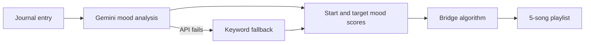

# NeuroLoom

A Streamlit app that turns a journal entry into a 5-song playlist, moving you step by step from your current mood towards a target mood.

Built by Vamika Bhat and Varsha Kodi for the Roll, Commit, Ship! hackathon at UTSAV 2026, where it won 2nd place.

**Contents:** [How it works](#how-it-works) · [Example](#example) · [Other features](#other-features) · [Run it](#run-it) · [Project layout](#project-layout) · [Limitations](#limitations)

## How it works



1. **Mood analysis:** Gemini reads the entry and returns a mood label, plus current and target scores for Energy and Valence (positivity), each from 0 to 1.
2. **Fallback:** if the Gemini call fails, keyword rules pick the mood instead, so the app still works without the API.
3. **Bridge:** `build_bridge` in [`core/bridge.py`](neuroloom/core/bridge.py) places 5 evenly spaced points on a straight line between the two moods. For each point, it picks the nearest unused song by Euclidean distance.

The target depends on the emotion. Someone overwhelmed is guided towards lower energy and higher valence, while someone happy is kept upbeat rather than pushed towards calm.

## Example

The entry "I feel overwhelmed and stressed about exams", analysed by the keyword fallback, starts at Energy 0.65, Valence 0.25 and targets Energy 0.20, Valence 0.62:

| Step | Song | Artist |
|---|---|---|
| 1 | Fix You | Coldplay |
| 2 | Creep | Radiohead |
| 3 | Teardrop | Massive Attack |
| 4 | Re: Stacks | Bon Iver |
| 5 | Holocene | Bon Iver |

## Other features

- **YouTube players** embedded in each song card
- **Weather-based themes** from OpenWeatherMap, with a manual switcher
- **Breathing exercise** with an animated orb
- **Hidden mode:** a three-dot sequence opens a full-screen, mouse-reactive particle field

## Run it

Requires a [Gemini API key](https://aistudio.google.com/apikey) and an [OpenWeatherMap key](https://openweathermap.org/api). Without them, the app uses its mood and weather fallbacks.

```bash
cd neuroloom
python -m venv venv
source venv/bin/activate
pip install -r requirements.txt
cp .env.example .env
```

Add your keys to `.env`, then run:

```bash
streamlit run app.py
```

## Project layout

```text
neuroloom/
├── app.py           Page flow and session state
├── config.py        Environment settings
├── data.py          27-song catalogue with Energy, Valence and Acousticness scores
├── styles.py        Base CSS and weather themes
├── core/
│   └── bridge.py    Bridge algorithm
├── services/
│   ├── gemini.py    Mood analysis and keyword fallback
│   ├── music.py     YouTube lookup and player
│   └── weather.py   Weather lookup and theme mapping
└── components/      Song cards, breathing orb, weather switcher, particle field
```

## Limitations

This is a hackathon project and isn't a medical or therapy tool.

- Journal entries are sent to Google's Gemini API, so don't enter anything sensitive.
- The catalogue has only 27 songs, which limits how closely a playlist can follow the line between two moods.
- YouTube IDs come from scraping search results, so lookups can break or return the wrong video.
- There are no automated tests yet.
- `gemini.py` and `journey_viz.py` include fortune-message and mood-chart code that the app doesn't display yet.
